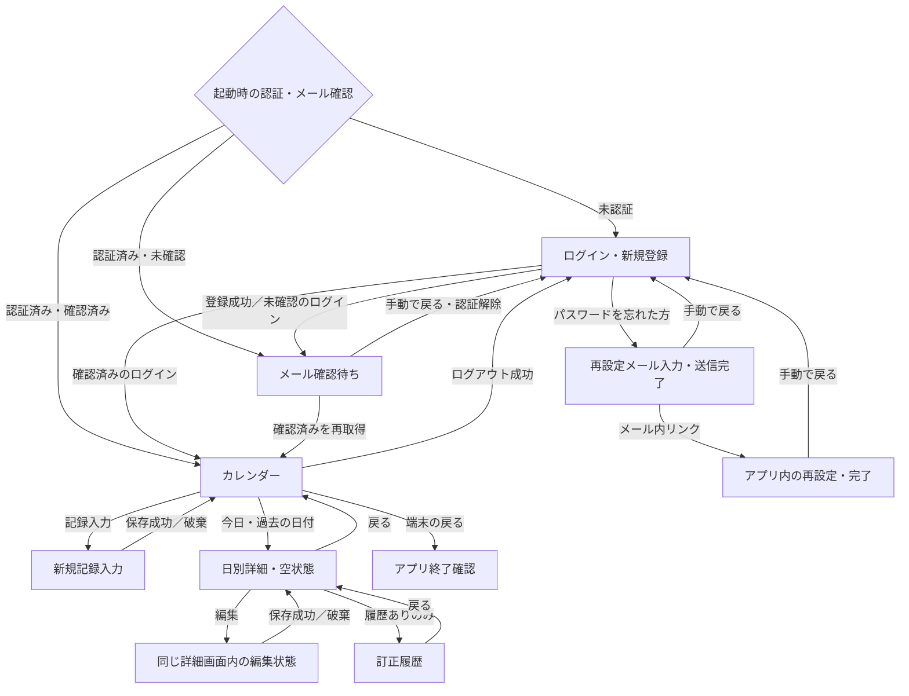

# Google Stitch用デザイン指示書 — 楽ちん報告アプリ（仮）

> このファイル全体をGoogle Stitchに渡してください。外部ファイルを読まなくても画面を構成できる、Prototype 1のデザイン用要件集です。
> 機能要件の正は既存の要件定義です。このファイルはその受け渡し用の写しと、今回のビジュアル提案をまとめています。機能を変更する場合は先に元の要件を更新し、このファイルを同期してください。
> グラデーションと不要なアウトラインを使わず、日本語のスマートフォン画面を、下記の画面一覧・状態一覧に従ってすべて作成してください。

## 1. Stitchへの制作依頼

あなたは日本語の健康記録アプリをデザインするUIデザイナーです。「楽ちん報告アプリ（仮）」の全画面と主要な操作状態を、統一されたデザインで作成してください。

目的は、血糖値・測定日時・食前／食後・短いメモ・食事写真を記録し、診察時に医師へ生活状況を説明しやすくすることです。スマートフォンに不慣れな人や文字の読みやすさを重視する人にも、次の操作がすぐ分かる画面にしてください。

制作物には、通常画面だけでなく、フォームの入力エラー、読み込み中、空状態、通信失敗、処理中、未保存確認、訂正確認、削除確認を含めてください。画面IDと状態IDを名前に付け、どの画面の派生状態か分かるようにしてください。

### 優先順位

1. 第5章の画面・第6章の状態を欠落なく構成する。
2. 第3章の遷移と第4章の入力条件を守る。
3. 数値・日時・主操作を読み取りやすくする。
4. 単色、余白、文字の強弱で整理し、グラデーション・装飾的な枠線を使わない。
5. 未定の機能を追加せず、要件で未指定の事項は第9章の扱いに従う。

### 作らない機能・画面

- AI予測、診断、合併症の予兆検知、血糖値に対する医学的判定。
- 平均値・グラフ・目標値・達成率・スコアを中心としたダッシュボード。
- 医師への送信、PDF出力、共有、予約、通知、服薬管理、ウェアラブル連携。
- Google／Appleログイン、プロフィール、設定、チュートリアル、追加のホーム画面。
- 本要件にないボトムタブ、サイドメニュー、課金画面。
- パスワード確認用の2つ目の入力欄、訂正理由の入力欄。

これらは今回の仕様に含まれません。説明用の装飾としても、操作可能に見える形で追加しないでください。

## 2. 共通ビジュアル仕様

ここで定める色・寸法・部品の形は今回のデザイン提案です。既存の機能要件に新しい機能は追加しません。

### 基本の見た目

- ライトテーマ。清潔で落ち着いた白と青を中心にする。
- 背景・ボタン・ヘッダー・カレンダー・写真の上を含め、グラデーションは全面禁止。
- 入力欄、カード、写真、ボタン、日付セルを一律に線で囲まない。
- 情報のまとまりは余白、淡い単色の面、見出しで表す。カードの入れ子を避ける。
- 装飾的な影、ガラス表現、立体ボタン、大きなヒーロー画像、健康系のストック写真は使わない。
- 必要なモーダルの浮き上がりだけ控えめに表現する。
- キーボード操作のフォーカス表示など、操作位置を伝えるための線は残す。「アウトラインを減らす」は操作状態の不可視化を意味しない。

### カラートークン

| 用途 | 色 | 使用ルール |
|---|---|---|
| 画面背景 | `#FFFFFF` | 全画面の基調。記録なしの日付も白背景 |
| 入力欄・補助面 | `#F3F4F6` | 枠線を使わず入力領域やまとまりを示す |
| 主操作・記録ありの日付 | `#1D4ED8` | 単色の青。上の文字は白 |
| 補助的な青の面 | `#EFF6FF` | 情報案内など。記録ありの日付背景の代用にはしない |
| 主文字 | `#111827` | 見出し、日時、数値、本文 |
| 補助文字 | `#4B5563` | 単位、説明、任意の案内 |
| エラー・削除 | `#B91C1C` | テキストとアイコンを併用。血糖値の医学的判定に使わない |
| エラー補助面 | `#FEF2F2` | 入力エラーの補助背景 |
| 無効状態 | 淡いグレーの面と文字 | 未来日・処理中の操作。状態は色だけに依存しない |

「血糖値が高い＝赤／低い＝青」といった判定は行わず、0〜600のすべての値を同じ文字色で表示する。

### 文字・余白・操作領域

- 日本語はNoto Sans JP相当の読みやすいサンセリフ。数値は桁が比較しやすい書体にする。
- 画面タイトル24px前後、本文・入力16px以上、補助14px以上を目安にする。
- 血糖値は新規入力で32px前後、一覧で28px前後。`mg/dL`は数値より小さくても読める大きさ。
- 390px幅を主なデザイン基準とし、320〜430px幅で内容が欠けない構成にする。
- 画面左右20px、セクション間24〜32px、関連項目間8〜12pxを目安にする。
- ボタン高52px前後、独立した操作のタップ領域は48px程度を確保する。
- カレンダーは7列を維持し、狭い幅ではセルサイズを調整する。日付の数字だけでなくセル全体を押せるようにする。
- 主ボタンは青い塗り。副操作は淡い塗りか文字ボタン。アウトラインボタンを並べない。
- 角丸は入力欄・ボタン12px前後、記録のまとまり16px前後。過度な丸みを付けない。
- 上下のセーフエリアを確保。フォームと一覧は縦スクロールできる。
- 文字拡大時は折り返し・高さの拡張を許可し、操作を隠さない。
- 下部の主操作はキーボード表示時にも到達でき、フォーム末尾や写真を覆わない。

### 共通部品

| 部品 | 表現 |
|---|---|
| ヘッダー | 戻る＋画面タイトル。カレンダーでは戻る矢印を出さず「ログアウト」を表示 |
| 入力欄 | 常時見えるラベル＋淡い塗りの入力面。プレースホルダーだけをラベルにしない |
| 必須／任意 | ラベル横に日本語で表示。任意の写真・メモも識別可能にする |
| 2択 | 淡い背景のセグメント。選択側は単色の青＋白文字。非選択側は濃い文字 |
| 日時 | ラベル付きの押せる面。入力可能なテキスト欄に見せず、ピッカーを開くことが分かる |
| 写真 | 同じ比率のサムネイル。編集できる場合のみ「変更」「削除」の操作を添える |
| 記録 | 時刻→血糖値→食前／食後→メモ→写真→操作の順に整理 |
| ローディング | 日本語の短い説明＋インジケーター。空状態の文言を同時に出さない |
| エラー | 入力不備は項目近く、記録の保存・更新・削除の処理失敗はダイアログ |
| 成功通知 | 手動操作が必要な認証系は画面内で完了を表示。記録保存は遷移後の簡潔な通知で補助可能 |
| 確認ダイアログ | 本文＋意味の分かる2つの操作。破棄・削除の実行を主操作の青と混同させない |

アイコンだけで重要な操作を表さない。戻るやパスワードの伏せ字などには読み上げ用ラベルを用意する。食前／食後の選択、訂正あり、エラーは文字でも状態を伝える。

## 3. 画面構成と遷移

### 全画面の制作リスト

| ID | 画面／状態 | 必須の制作内容 |
|---|---|---|
| S01 | ログイン・新規登録 | 同じ画面のログインモードと新規登録モードをそれぞれ作る |
| S02 | メール確認待ち | 確認手順・確認状態の再確認・再送・ログインへ戻る |
| S03 | パスワード再設定メールのアドレス入力 | 入力状態と送信完了状態をそれぞれ作る |
| S04 | アプリ内のパスワード再設定 | 新パスワード入力と再設定完了をそれぞれ作る |
| S05 | カレンダー | 記録あり／なし／今日／未来日が同じ月に混在する状態 |
| S06 | 新規記録入力 | 初期状態と、写真3枚・メモありの入力状態 |
| S07 | 日付ごとの詳細 | 複数記録、訂正あり、空状態をそれぞれ作る |
| S08 | 日別詳細内の編集状態 | S07と同じ画面内の状態として作る。別の新規入力画面にはしない |
| S09 | 訂正履歴 | 複数回の訂正を新しい順で確認する閲覧専用画面 |

起動時の確認中表示は状態ST01とする。独立したブランド用スプラッシュ画面を新設しない。日付／時刻ピッカー、写真の選択操作、各確認ダイアログは第6章の付属UIとして制作する。

### 遷移のルール

- 起動時、未認証ならS01、認証済み・メール未確認ならS02、認証済み・メール確認済みならS05。
- S01の「ログイン」「新規登録」は同じ画面内の切り替え。メールアドレスは保持し、パスワードはクリアする。
- 新規登録・認証が成功したら確認メールを送りS02へ。メール送信だけ失敗してもアカウントを作り直さずS02で再送する。
- S02で「確認が完了しました」を押し、確認済みと再取得できた場合だけS05へ進む。
- S02からログインへ手動で戻るときは認証を解除する。解除前に戻った扱いにしない。
- S01の「パスワードを忘れた方」→S03。受信した再設定リンク→アプリ内のS04。
- S03送信完了・S04再設定完了からS01への移動はユーザーの手動操作。自動遷移しない。
- S05「記録入力」→S06。保存成功／入力破棄→S05。過去の日時も記録可能。
- S05で今日または過去の日付を押す→S07。記録0件でも移動可能。未来日は表示のみ。
- S07「編集」→同じ詳細画面のS08状態。「訂正履歴」→S09。
- S07からS06へは移動させず、「記録を追加」ボタンも置かない。新規追加はカレンダーからのみとする。
- S08保存成功で日付が同じなら元の日のS07、日付が変わったら変更後の日のS07。カレンダーも変更前後の両日を更新する。
- S08で編集を破棄すると元の日のS07へ。S09で戻ると履歴を開いた元の日のS07へ。
- S07で戻る→S05。S05でログアウト成功→S01。戻る操作で認証後の画面を再表示しない。
- S05で端末の戻る操作→終了確認。キャンセルならS05、終了ならアプリ終了。
- 処理失敗・結果が不明な場合は成功先へ進めない。元の画面・入力内容を保持する。

### デザイン用遷移図

この図は受け渡し用の写し。元の遷移図は `docs/skills/app-flow/SKILL.md` で管理する。

## 4. 記録と処理の共通要件

### 1件の記録の入力条件

| 項目 | 条件 | UIへの反映 |
|---|---|---|
| 測定日時 | 必須。新規入力は現在日時。今日以前、かつ現在より未来の時刻は禁止 | 日付ピッカー→時刻ピッカー。未来日は最初から無効にし、未来日を手入力する経路を作らない |
| 血糖値 | 必須、整数0〜600、単位mg/dL固定。小数不可 | 数値入力欄、単位の固定表示、常時見える「0〜600の整数」の説明 |
| 測定タイミング | 必須、食前／食後のみ | 2択の選択部品。選択済みが文字と面で分かる |
| メモ | 任意、最大50文字（既存の仮仕様） | 複数行入力、`現在文字数/50`。残りや超過が分かる |
| 食事写真 | 任意、0〜3枚。カメラ撮影／端末内写真を選択 | 枚数を`0/3`〜`3/3`で表示。3枚なら追加操作を無効にする |

日時は日本国内での利用を前提とした端末の日本時間。タイムゾーン変更への対応は対象外。日付は`2026年10月14日（水）`、時刻は`12:30`など24時間表記に統一する。

測定器に保存されている測定値・測定日時を正とし、アプリの入力内容を合わせる。0と600は保存可能な境界値であり、入力範囲だけを理由に異常値として警告しない。

未来時刻も選択段階で制限する。今日の日付では現在より後の時刻を無効にする。制約のない時刻入力を提示し、保存時のエラーだけで未来時刻を防ぐデザインにしない。

### 保存・更新・削除

- オンライン時だけ実行する。オフラインで予約・自動再送・保留保存を行わない。
- 記録・写真・必要な訂正履歴の処理がすべて成功した場合だけ完了とする。
- 失敗・結果不明の場合は入力を保持し、成功通知や成功先への遷移を行わない。
- 更新・削除失敗時は最後に正常保存された記録・写真・訂正履歴を保持する。
- 写真だけ処理済みなどの中間状態を保存完了として見せない。結果確認・後始末が必要な間は処理中として扱う。
- 処理中は二重実行を防ぎ、ボタンに「保存中…」「更新中…」「削除中…」などを表示する。写真変更や入力変更も停止し、処理対象を変えない。
- 再試行はユーザーによる操作。同じ記録・訂正履歴を重複作成しない。
- 入力エラーは該当項目の近くに表示。保存・更新・削除失敗は日本語のエラーダイアログを表示する。
- 通信不可の文言は「通信できません。接続を確認して、もう一度お試しください。」。
- 未対応の処理エラーの文言は「処理に失敗しました。もう一度お試しください。」。

### 訂正履歴

- 保存済みの血糖値または測定日時を変更した場合だけ訂正対象。
- 保存前に訂正確認を表示し、「訂正する」を押して保存が成功した時点で履歴を作成する。
- 変更なし、キャンセル、保存失敗では履歴を作らない。以前と同じ値に戻す変更でも新たな履歴を追加する。
- 測定タイミング・メモ・写真の変更は履歴対象外。最新の状態を保持する。
- 訂正履歴には訂正日時、訂正前後の血糖値・測定日時を表示。訂正理由の入力、ユーザー名・メールアドレスの表示は行わない。
- 記録が存在する間はすべての履歴を保持し、上書き・編集・単独削除不可。記録全体を削除する場合のみ写真と履歴も削除する。

## 5. 画面別デザイン

### S01 ログイン・新規登録

上から、アプリ名、短い目的説明「日々の記録を、診察で伝えやすく。」、ログイン／新規登録の切り替え、入力欄、主ボタンを配置する。狭い端末やキーボード表示時はスクロール可能にする。

- 両モードとも必須項目は「メールアドレス」「パスワード」の2つのみ。
- パスワードは伏せ字。新規登録では「8文字以上・英字と数字をそれぞれ1文字以上。記号も使えます。」を表示する。
- ログインモードの主ボタンは「ログイン」。補助リンクに「パスワードを忘れた方」。
- 新規登録モードの主ボタンは「新規登録」。メール確認が必要であることを短く案内する。
- モード切り替えでメールアドレスは保持、パスワードはクリア。
- 処理中は重複送信とモード切り替えを防止する。
- 認証失敗は同じモードに留まり、「メールアドレスまたはパスワードが正しくありません」などを表示する。
- 登録失敗の例は「登録できませんでした。入力内容を確認してください」。通信失敗も日本語で案内する。
- 成功後の遷移はメール確認状態で分岐する。認証済み・確認済みで起動した場合はこの画面を経由しない。

### S02 メール確認待ち

タイトル「メールアドレスの確認」。小さなメールアイコン、送信先メールアドレス、確認手順、主ボタン、副操作、戻る操作の順に配置する。

- 通常案内は「確認メールのリンクを開いたあと、この画面で確認してください。」。
- 主ボタン「確認が完了しました」で確認状態を再取得する。ボタンを押しただけでは確認済み扱いにしない。
- 副操作「確認メールを再送する」。再送成功は画面内で通知する。
- 未確認なら「メールアドレスの確認が完了していません。」と表示し、留まる。
- 初回メール送信失敗、再送失敗、確認状態の取得失敗は区別して表示し、再試行可能にする。初回送信失敗なのに「送信しました」と表示しない。
- 登録済み・未確認でログイン／再起動した場合もこの画面を使用する。
- 手動で「ログイン画面へ戻る」場合は認証解除が必要。戻る操作の処理中・失敗状態も表現する。

### S03 パスワード再設定メール入力・送信完了

入力状態は戻る、タイトル「パスワードの再設定」、案内、必須の「メールアドレス」、主ボタン「再設定メールを送信」の順。

- 登録済みメールアドレスを入力する。処理中は重複送信不可。
- 失敗は入力状態に留まり、原因に応じた日本語エラー。
- 送信成功は同じ画面の完了状態として「再設定メールを送信しました」と表示し、メール内リンクからアプリ内で新しいパスワードを設定する手順を案内する。
- 完了状態には「ログイン画面へ戻る」を設ける。通常の戻る操作も可能。自動でログイン画面に移動しない。

### S04 アプリ内のパスワード再設定・完了

メール内リンクから開く。タイトル「新しいパスワードを設定」、必須の「新しいパスワード」、条件案内、主ボタン「パスワードを設定」。

- リンクのコード確認中は読み込み表示。有効と確認できるまで設定を実行できない。
- 新規登録と同じ8文字以上・英字1文字以上・数字1文字以上。記号は任意。伏せ字で表示する。
- 無効／期限切れのリンク、コード検証の通信失敗、設定失敗は別状態として制作する。
- 無効／期限切れでは完了にせず、「リンクが無効か、有効期限が切れています。ログイン画面から再設定メールを送信してください。」と案内し、手動でログインへ戻れるようにする。
- 再設定成功は「パスワードを再設定しました」。主操作「ログイン画面へ戻る」。新しいパスワードでログインすることを案内し、自動ログイン／自動遷移はしない。
- 通常の戻る操作でログインへ戻れる。未完了の内容は確定しない。専用の再設定取り消し機能は設けない。

### S05 カレンダー

タイトル「カレンダー」、右側に文字付きの「ログアウト」。月表示、曜日、7列の月間カレンダー、凡例、下部の主ボタン「記録入力」の順に配置する。

- 認証済み・メール確認済みユーザーの最初の画面。
- 記録ありの日付部分は単色の青背景＋白文字。記録なしは白背景。血糖値で日付の色を変えない。
- 今日の数字は太字と小さな印などで識別し、青背景の記録あり／なしとは別の意味だと分かるようにする。凡例「青い日付：記録あり」を表示する。
- 今日・過去の日付は記録がなくてもタップ可能。未来日は文字を弱め、押しても選択や遷移を起こさない。「未来の日付は選択できません」と補足する。
- 記録追加・編集・削除後に最新状態へ更新。日付変更では変更前後の両日を更新。
- 読み込み中、取得失敗、全日記録なしを区別。取得失敗時に未取得の日を「記録なし」と断定しない。失敗時は「記録を取得できませんでした」と「再試行」。
- ログアウト中は再操作を防ぐ。成功したら認証後の画面履歴と本人の表示データを解除。失敗ならカレンダーに留まり、日本語エラー。
- 端末の戻る操作では終了確認。ヘッダーにログインへ戻る矢印を置かない。
- 月移動の具体的なUIは第9章のビジュアル提案を参照。

### S06 新規記録入力

タイトル「記録入力」。入力順は、測定日時、血糖値、測定タイミング、メモ、食事写真、主ボタン「記録を保存」。血糖値の入力を十分に大きくし、任意項目との優先度を区別する。

- 測定日時は開いた時点の現在日時。日付と時刻を読みやすく表示し、変更は日付ピッカー→時刻ピッカー。
- 「※現在より未来の日時は選択できません。」を日時の近くに表示する。
- 血糖値は初期状態で空。`mg/dL`は入力値に含めず固定表示。食前／食後も選択を促す。
- メモには文字数。例文はプレースホルダーとして「例：昼食後に散歩」。入力済みの記録に見せない。
- 写真エリアには「カメラで撮影」「写真を選択」。選択済みサムネイルと枚数を表示。3枚で追加不可、削除すれば追加可能。
- 保存前の写真削除は添付候補を外す操作。記録全体を削除する確認とは区別する。
- 入力不備は該当項目近くに表示する。未来日時が保存処理まで到達した場合は「未来の日時では保存できません。日時を確認してください。」。
- 保存中・失敗は第4章に従う。写真を含む全処理成功後だけカレンダーへ戻る。
- 成功後は入力を破棄し、次回は新規入力状態。未保存内容がある状態で戻る場合は確認。キャンセルなら入力を保持する。
- 日別詳細から新規記録を追加する経路は設けない。

### S07 日付ごとの詳細

ヘッダーの戻る、タイトル「2026年10月14日（水）」、記録一覧の順。測定日時の日付に属する記録を表示し、登録日で分類しない。

- 時刻の昇順、古い時刻→新しい時刻で並べる。同じ日の複数記録を縦に確認できる。
- 各記録は時刻、血糖値＋mg/dL、食前／食後、任意メモ、0〜3枚の食事写真、「編集」「削除」を表示。
- メモ・写真なしの記録は余分な空枠を置かず簡潔に表示する。
- 訂正履歴ありなら現在の値・日時を通常表示し、「訂正あり」と「訂正履歴」操作を付ける。履歴なしなら両方を出さない。
- 編集はこの画面内のS08状態へ。新規入力画面へ移動しない。
- 削除は確認後に実行。記録・写真・履歴すべて成功で完了。残る記録が0件なら空状態へ。
- 空状態の本文は「この日の記録はありません」。追加ボタンは置かず、戻る操作でカレンダーへ戻る。必要なら「記録入力はカレンダーから行えます」と操作場所を案内する。
- 読み込み中・取得失敗・空状態を分ける。取得失敗には再試行操作。

### S08 日別詳細内の編集状態

S07のヘッダーと日付の文脈を維持し、対象記録の表示領域を入力フォームに置き換える。対象の時刻と「記録を編集」を表示し、別画面への遷移や新規記録入力に見せない。ほかの記録への操作は編集中に抑える設計を提案する。

- 初期値は対象記録の最後に正常保存された測定日時・血糖値・食前／食後・メモ・写真。日時を現在に上書きしない。
- 全項目が編集可能。入力条件・写真3枚・メモ50文字・未来日時禁止は新規入力と同じ。
- 写真は変更・削除・追加が可能。操作が記録に確定するのは保存成功後。
- 主ボタン「変更を保存」。副操作「戻る」で一覧状態へ戻る。未保存変更があるなら編集破棄確認を表示する。
- 血糖値／測定日時の差分がある場合だけ訂正確認を表示する。確認には変更前後の値・日時を添えて比較しやすくする。
- 食前／食後、メモ、写真だけの変更なら訂正確認・履歴作成は行わない。
- 訂正確認のキャンセル、保存失敗は入力を保持したまま編集状態に留まる。
- 保存成功後、日付変更なしは同じ日の一覧。日付変更ありは変更後の日の一覧へ移り、カレンダーの両日を更新する。
- 編集途中でアプリを終了しても未保存内容は保存しない。次回は最後に正常保存された内容を表示する。

### S09 訂正履歴

タイトル「訂正履歴」、対象記録の現在の測定日時と血糖値、履歴一覧の順。訂正日時の降順、新しい訂正→古い訂正で並べる。

- 各履歴は「訂正日時」、次に「訂正前」「訂正後」をラベル付きで表示。
- 前後どちらにも血糖値と測定日時の両方を表示する。片方だけ変えた場合も両方を見せる。
- 狭い画面では前→後を縦に並べ、数値・日時を省略しない。横並びを無理に押し込まない。
- 複数回の訂正はすべて表示。取り消し、編集、削除、元に戻す操作は置かない。
- ユーザー名・メールアドレス・訂正理由・写真の変更履歴は表示しない。
- 読み込み中と取得失敗を制作し、失敗時に「履歴なし」と見せない。
- 戻ると、履歴を開いた元の記録がある日別詳細へ戻る。

## 6. 追加制作する状態・付属UI

各状態を通常画面とは別のアートボードとして作成し、IDと親画面を明記する。同じ部品を使う状態は外観を統一し、画面ごとの文言や戻り先を保持する。

| 状態ID | 対象 | 制作内容・動作 |
|---|---|---|
| ST01 | 起動 | 認証・メール確認の取得中。確定前に記録を表示しない。取得できない場合も推測でカレンダーへ進めない |
| ST02 | S01 | ログイン／新規登録処理中、入力不備、認証失敗、登録失敗、通信失敗 |
| ST03 | S02 | 未確認、初回確認メール送信失敗、再確認中／失敗、再送中／成功／失敗、戻る際の認証解除中／失敗 |
| ST04 | S03 | 必須入力エラー、送信中、送信失敗、送信完了 |
| ST05 | S04 | リンク検証中、検証の通信失敗、無効／期限切れ、条件未達、設定中、設定失敗、設定完了 |
| ST06 | S05 | 記録あり／なし混在、記録なしの月、読み込み中、取得失敗＋再試行 |
| ST07 | S06・S08 | 血糖値未入力／小数／範囲外、食前／食後未選択、メモ上限、未来日時の保存防御エラー |
| ST08 | S06・S08 | 日付ピッカー→時刻ピッカー。未来日は無効、今日の未来時刻も無効。手入力で制約を迂回できない |
| ST09 | S06・S08 | 写真0枚／1枚／3枚、撮影／選択、添付を外す、保存済み写真を変更・削除。3枚では追加不可 |
| ST10 | S06 | 未保存入力の破棄確認。「入力内容が保存されていません。戻りますか？」。操作は「キャンセル」「戻る」 |
| ST11 | S08 | 未保存編集の破棄確認。「編集内容が保存されていません。戻りますか？」。操作は「キャンセル」「戻る」 |
| ST12 | S08 | 訂正確認。「血糖値または測定日時が変更されています。この内容で訂正しますか？」。操作は「キャンセル」「訂正する」。変更前後も表示 |
| ST13 | S07 | 削除確認。「この記録と写真・訂正履歴を削除しますか？」。操作は「キャンセル」「削除」 |
| ST14 | S06・S08・S07 | 保存中／更新中／削除中。二重実行不可。結果確認中も成功に見せない |
| ST15 | S06・S08・S07 | 保存／更新／削除失敗の日本語ダイアログ。内容を保持。閉じたら元の状態で手動再試行可能 |
| ST16 | S06・S08・S07 | オフラインのエラーダイアログ。第4章の通信不可文言。自動送信の予約・保留表示なし |
| ST17 | S07 | 複数記録、訂正あり／なし、メモ・写真なし、空状態、読み込み中、取得失敗＋再試行 |
| ST18 | S09 | 複数訂正、読み込み中、取得失敗＋再試行 |
| ST19 | S05 | ログアウト中、ログアウト失敗。成功時だけS01へ戻る |
| ST20 | S05 | 終了確認。「アプリを終了しますか？」。操作は「キャンセル」「終了」 |
| ST21 | S06・S08 | 写真権限拒否・取得失敗時の補助表示案。写真を選べていない状態を添付済みにしない。撮影／選択のキャンセルは添付を変更しない |

ST21のエラー文言は既存要件で未指定のため、デザイン上の提案として扱う。端末の写真・カメラ権限ダイアログ自体をアプリ独自の設定画面に置き換えない。

### エラー表示の文言

| 場面 | 文言 |
|---|---|
| 血糖値未入力 | 「血糖値を入力してください。」（デザイン提案） |
| 血糖値が小数／範囲外 | 「血糖値は0〜600の整数で入力してください。」（デザイン提案） |
| 食前／食後未選択 | 「測定タイミングを選択してください。」（デザイン提案） |
| メモ上限 | 「メモは50文字以内で入力してください。」（デザイン提案） |
| 未来日時の保存 | 「未来の日時では保存できません。日時を確認してください。」 |
| オフライン | 「通信できません。接続を確認して、もう一度お試しください。」 |
| 未対応の処理エラー | 「処理に失敗しました。もう一度お試しください。」 |
| メール未確認 | 「メールアドレスの確認が完了していません。」 |

必須入力が不足している段階でも、何が必要か常に分かるようにする。数値入力や文字数制限の実装方式は要件の範囲で選べるが、制限理由と修正する項目を隠さない。

## 7. 画面に使用する架空データ

デザインの基準日時は **2026年10月14日（水）20:00、日本時間**。14日は今日、15日以降は未来日として無効にする。実際の利用時は端末の現在日時で判定する。以下は画面制作専用の架空データであり、医学的な評価は付けない。

| 表示対象 | 架空データ |
|---|---|
| 認証のメールアドレス | `sample@example.com` |
| カレンダー | 2026年10月。10日・12日・14日は記録ありの青背景、13日は記録なしの白背景、15日以降は選択不可 |
| 14日の記録1 | 07:30、108 mg/dL、食前、メモなし、写真なし、訂正履歴なし |
| 14日の記録2 | 12:30、142 mg/dL、食後、「昼食後に散歩」、食事写真1枚、訂正履歴あり |
| 14日の記録3 | 19:00、136 mg/dL、食後、「夕食を記録」、食事写真3枚、訂正履歴なし |
| 13日の日別詳細 | 「この日の記録はありません」 |
| 記録2の最新訂正 | 訂正日時：14日15:10。訂正前：145 mg/dL／14日12:35。訂正後：142 mg/dL／14日12:30 |
| 記録2の以前の訂正 | 訂正日時：14日14:00。訂正前：150 mg/dL／14日12:35。訂正後：145 mg/dL／14日12:35 |

訂正履歴では年・月を含めた完全な測定日時を表示する。上の省略表記をそのまま履歴UIに使わない。写真は利用者が添付した食事のサンプルとし、画面背景や装飾写真として使用しない。伏せ字のパスワードに実在の認証情報を使わない。

## 8. 制作完了のチェックリスト

- [ ] S01〜S09がそろい、S01の2モード、S03・S04の完了状態、S07の空状態がある。
- [ ] S08は日別詳細内の編集状態と分かり、新規入力とは区別されている。
- [ ] ST01〜ST21がそろい、読み込み中・0件・取得失敗が混同されていない。
- [ ] 全画面が日本語。日時、mg/dL、食前／食後、写真数、文字数の表示が統一されている。
- [ ] グラデーションがなく、入力欄・カード・日付・ボタンを装飾的なアウトラインで囲っていない。
- [ ] 青背景は記録ありの日付に使われ、記録なしの日付は白背景。今日の印とは意味が区別されている。
- [ ] 未来日のタップと未来日時の入力を選択段階で防ぐUIがある。
- [ ] 血糖値0〜600の整数、メモ50文字、写真最大3枚が伝わる。
- [ ] 写真0枚／メモなしでも保存可能だと分かる。
- [ ] 日別詳細は古い時刻から、訂正履歴は新しい訂正から並ぶ。
- [ ] 訂正ありの記録だけに「訂正あり」と「訂正履歴」が表示される。
- [ ] 訂正確認・編集破棄・新規入力破棄・記録削除・アプリ終了の確認が区別されている。
- [ ] 再設定完了後に手動でログインへ戻る操作があり、自動遷移を前提にしていない。
- [ ] 処理失敗後に入力が残り、オフラインで自動送信されるような表現がない。
- [ ] 小さい画面・キーボード表示・文字拡大でも入力内容と操作に到達できる。
- [ ] AI、医学的判定、共有、グラフなど対象外の機能が追加されていない。
- [ ] 第9章の未確定事項を確定済みと見せず、提案と機能要件を区別している。

## 9. 要件で未指定の事項の扱い

### 既存要件で未指定のため、今回のビジュアル提案として扱うもの

- 曜日の並びは月曜始まり、月切り替えは年月の左右の前月／翌月ボタンを提案する。未来日がある月でも未来日は選択不可。月切り替えの範囲は既存要件で未指定。
- 今日の識別は太字＋小さな印を提案する。記録ありの青背景を今日専用に流用しない。
- 新規入力の食前／食後は未選択状態を提案する。既存要件は必須の2択を定めているが、初期選択を指定していない。
- 詳細画面内の編集は、対象記録をフォームに置き換え、ほかの記録の操作を抑える構成を提案する。同時編集数は既存要件で未指定。
- 写真のサイズ・容量・圧縮条件、保存可能な最古の日付、同一測定日時の記録の並び順、メール再送の待ち時間は未指定。具体的な上限やカウントダウンを勝手に表示しない。
- 写真権限・取得失敗、認証の一部エラー、取得失敗時の文言など、元要件が文字列を指定していない箇所は日本語の提案文言として扱う。

## 10. 要件との対応・実装時に守る事項

この章は受け渡し内容の確認用。バックエンド名、課金設定、セキュリティ用語を通常の利用者向け画面に表示する必要はない。

| 要件の正 | このファイルの対応 |
|---|---|
| `docs/skills/app-flow/requirements-definition/common.md` | 第1章の目的・対象範囲、第4章の処理、第10章の保存・セキュリティ |
| `docs/skills/app-flow/requirements-definition/login.md` | S01〜S04、S05のログアウト、ST01〜ST05・ST19 |
| `docs/skills/app-flow/requirements-definition/calendar.md` | S05、ST06、今日・過去・未来日と記録有無の表示 |
| `docs/skills/app-flow/requirements-definition/record-input.md` | 第4章の入力条件、S06、ST07〜ST10・ST14〜ST16 |
| `docs/skills/app-flow/requirements-definition/daily-detail.md` | S07〜S09、訂正履歴の条件、ST11〜ST18 |
| `docs/skills/app-flow/SKILL.md` | 第3章の遷移・戻る・終了確認 |

### UIでは省略してよいが、実装の要件から除外してはいけない事項

- アプリはFlutter／Dart、スマートフォン対象、Prototype 1。認証はFirebase Authentication、記録はCloud Firestore、写真はCloud Storage for Firebase。
- 現在の実装はSQLite保存・ログイン未実装のため、既存の画面実装だけを要件の完成形として扱わない。
- 記録・写真・訂正履歴は本人のものだけ表示・操作できる。未認証・メール未確認のユーザーは認証後画面を利用できない。ユーザー切り替え時に他人の表示データを残さない。
- アプリ再起動後も保存済み記録と写真を取得できる。認証状態が有効でメール確認済みなら起動時にカレンダーへ進む。
- アクセス制御は画面だけに依存せず、Authentication・Security Rules・App Check・テストと監視を組み合わせる。本人確認・入力条件・訂正履歴の単独変更禁止をサーバー側でも検証する。
- App CheckはFirestoreとStorageに適用し、公開前に実機確認と強制適用を行う。本番に開発用のデバッグ設定を含めない。
- 記録・写真・パスワード・認証トークンを監視ログに出さない。正規アクセスの拒否や不自然な利用量を監視する。
- 既存SQLiteデータを自動移行・無断削除しない。新規Firebaseプロジェクトや課金設定は画面制作とは別の実装作業。
- Cloud Storage利用に伴う課金設定の有効化は別途ユーザー確認が必要。この指示書の作成は課金設定の許可を意味しない。
- 複数サービス間の保存・更新・削除は、失敗時のデータ保持、準備した写真の後始末、結果不明時の確認、重複防止まで含めて実装する。

## 11. 一度で全画面を構成できない場合の分割指示

分割して依頼する際も、このファイル全体を共通の仕様として渡す。各回で色・文字・部品を変更せず、既に作った画面と統一する。

1. **認証**：S01〜S04とST01〜ST05。新規登録・ログインの切り替え、メール確認待ち、再設定の完了まで制作する。
2. **記録と閲覧**：S05〜S07、ST06〜ST10、ST17、ST19〜ST21。カレンダー、新規入力、日別詳細、空状態を制作する。
3. **編集と履歴**：S08〜S09、ST07〜ST09、ST11〜ST18、ST21。詳細画面内編集、訂正確認、履歴、削除、処理失敗まで制作する。
4. **統合確認**：第8章のチェックリストで全画面を照合し、欠けた状態と部品の不統一を修正する。

最初の画面だけを完成扱いにしない。すべてのIDが確認できる画面一覧と、各画面の通常状態・派生状態をそろえる。
