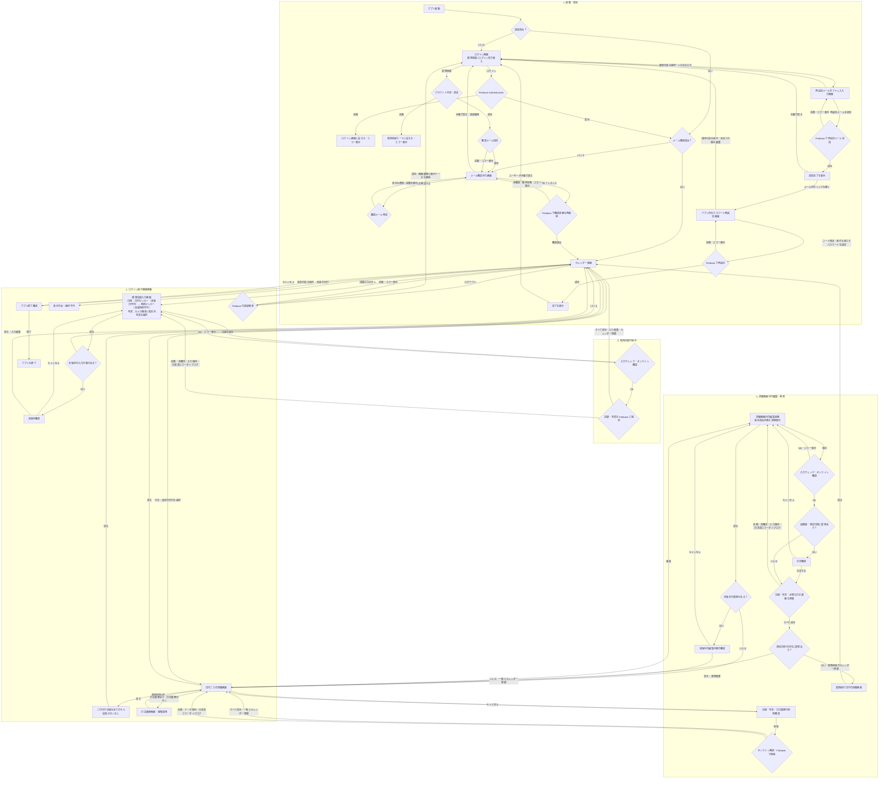

## 要件定義へのリンク

以下はこのファイルを基準とした相対パス。画面ごとの入力・表示要件はリンク先を正とし、このファイルでは画面遷移を定義する。

| 対象 | 要件定義の相対パス |
|---|---|
| 共通（目的・技術・対象範囲・完成条件） | [requirements-definition/common.md](requirements-definition/common.md) |
| ログイン・新規登録・メール確認待ち・パスワード再設定画面 | [requirements-definition/login.md](requirements-definition/login.md) |
| カレンダー画面 | [requirements-definition/calendar.md](requirements-definition/calendar.md) |
| 記録入力画面 | [requirements-definition/record-input.md](requirements-definition/record-input.md) |
| 日付ごとの詳細画面（画面内編集・削除・訂正履歴画面を含む） | [requirements-definition/daily-detail.md](requirements-definition/daily-detail.md) |

## 画面遷移のルール

- 画面遷移を Mermaid で 1 枚にまとめる
- 画面を増やすときは `requirements-definition/` に要件定義を置き、上の表と Mermaid 図を更新する。関連画面を既存の要件定義ファイル内で定義する場合も、表に対象画面を明記する
- 戻る動作の扱いを書く
- ログイン画面内で「新規登録」と「ログイン」を切り替える（別画面への遷移ではない）
- 認証済みかつメールアドレス確認済みの場合のみカレンダーへ遷移し、戻る操作でログイン画面へ戻さない。未確認の場合は確認待ち画面を表示する
- 新規記録の入力画面はカレンダーからのみ開き、保存成功後・入力を破棄して戻る場合はカレンダーへ戻る
- 詳細画面内で保存済み記録を編集・削除する。詳細画面から新規入力画面へは遷移しない
- 詳細画面から訂正履歴画面を開き、戻る操作で元の日付の詳細画面へ戻る
- カレンダーからログアウトした場合は認証後の画面履歴を解除し、ログイン画面へ戻る
- 再設定メールのリンクからアプリ内のパスワード再設定画面を開く。完了後はユーザーが手動でログイン画面へ戻る
- 日付ごとの詳細画面から戻る操作でカレンダーへ戻る
- カレンダー画面で端末の戻る操作をした場合、
  「アプリを終了しますか？」と確認を表示する。
- ユーザーが終了を選択した場合のみ、アプリを終了する。
- キャンセルした場合は、カレンダー画面に留まる。
- 入力画面の保存後・未保存時の動作、一覧の並び順、編集・削除可否は各画面の要件定義で管理する
- Firebase の採用理由: ユーザー指定により、ログインと記録保存を Firebase で扱う仕様へ変更する
- 写真保存の採用理由: ユーザー指定により写真も Firebase で管理するため、Cloud Storage for Firebase を使用する（課金設定の扱いは common.md を参照）
- 決めていないことは TODO: 要確認 と書く

## 図の読み方

上から「起動・認証」「ログイン後の画面移動」「新規記録の保存」「詳細画面内の編集・削除」の順に読む。
線の交差を避けるため、同じ画面を遷移先として再掲している。同名の箱は同じ画面を指し、新しい画面ではない。
エラー時の「画面に留まる」や詳細画面内の編集状態も、別画面への遷移ではなく、その場での表示更新を表す。

